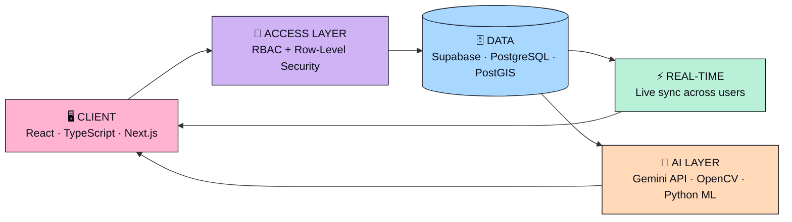

<div align="center">



<br/>

[](#-whoami)
[](#-how-i-build)
[](#-capability-matrix)
[](#-deployed-modules)
[](#-open-channel)

<a href="https://github.com/jagtapmansis006-glitch">
  
</a>

</div>


## ⌘ whoami

```console
mansi@portfolio:~$ cat profile.json
{
  "name":        "Mansi Sanjay Jagtap",
  "role":        "Full-Stack Developer",
  "studying":    "B.E. Electronics & Telecommunication",
  "university":  "University of Mumbai (2028)",
  "superpower":  ["Row-Level Security", "AI integrations"],
  "hackathon":   "HackCelestial 3.0 🏆",
  "lookingFor":  "Internships & strong teams to build with",
  "status":      "ONLINE ●"
}

mansi@portfolio:~$ echo $PITCH
I build role-based web platforms people can actually use —
secure by default (PostgreSQL RLS), live by design (real-time sync),
and smarter with AI (Gemini API · OpenCV · Python ML).
```


## ⌘ how I build

Every platform I ship follows the same pipeline — security and data integrity first, then real-time, then intelligence.




## ⌘ capability matrix

What I can build, what I use with working knowledge, and what I haven't done yet. Being upfront about all three.



<div align="center">


</div>


## ⌘ deployed modules

> ✏️ **Replace the placeholders with your real projects.** Recruiters spend most of their time on this section.

| Module | What it does | Stack | Status | Links |
|:--|:--|:--|:--:|:--|
| **🌸 PROJECT_01** | One line: what it does and for whom. Mention RLS / roles / realtime. | `React` `TypeScript` `Supabase` | 🟢 Live | [Demo](#) · [Code](#) |
| **💜 PROJECT_02** | One line: the AI feature and the problem it solves. | `Python` `Streamlit` `OpenCV` | 🟢 Live | [Demo](#) · [Code](#) |
| **💙 PROJECT_03** | One line: the geospatial or realtime feature. | `Next.js` `PostGIS` `Supabase` | 🟡 Building | [Code](#) |
| **🏆 HACKCELESTIAL_3.0** | What you built, your role, and the result. | add stack | 🏅 Achievement | [Project](#) |


## ⌘ credentials

<div align="center">


</div>


## ⌘ telemetry

<div align="center">


</div>


## ⌘ open channel

```console
mansi@portfolio:~$ ./connect --mode=internship --available=true
> channel opened. say hello ↓
```

<div align="center">

<a href="https://www.linkedin.com/in/YOUR-LINKEDIN-ID"></a>
<a href="mailto:YOUR-EMAIL@gmail.com"></a>
<a href="YOUR-PORTFOLIO-URL"></a>
<a href="https://github.com/jagtapmansis006-glitch"></a>

<br/><br/>

<sub><code>// make it work, make it right, make it pretty. 🌸</code></sub>

</div>
